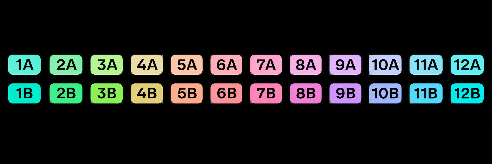

# Spotify Key Organiser

Sorts your Spotify **Liked Songs** into one playlist per musical key (`1A`, `7B`, `12B`, ...), so you can find songs that mix well together.

## The problem

Songs in compatible keys blend smoothly when you mix from one into the next. Songs in clashing keys sound off. DJs use the **Camelot wheel** to make this easy: every key gets a number from 1 to 12 and a letter, A for minor and B for major. Two songs mix well if they have:

- the **same** key (`8A` to `8A`)
- a number **one step away**, same letter (`8A` to `7A` or `9A`)
- the **same number, other letter** (`8A` to `8B`)

I had about 1,900 liked songs and wanted them grouped by key, so I could open `8A` and see everything that mixes with what's playing. Spotify shows each song's key in its desktop app, but there's no way to sort or filter by it, and doing 1,900 songs by hand wasn't realistic.

The obvious route doesn't work any more: **Spotify's Web API stopped returning audio features (key, BPM) to new apps in November 2024.** So this tool reads the key from the desktop app's screen instead.

## How it works

1. It puts the next 10 liked songs into a private playlist called `temp`, with one API call that replaces whatever `temp` held before.
2. It waits for the desktop app to redraw. It knows the new batch is showing when the song titles change and the picture stops changing for a few frames.
3. It takes a small screenshot of just the title and Key columns.
4. Each key appears as a coloured label. The colour identifies the key (see [Key colours](#key-colours)), and the row the label is on identifies the song, because the songs were sent in a known order. No text recognition is needed.
5. It repeats for every liked song and saves `{track: key}` to `results/scanned_keys.json`. That takes about 4 minutes for 1,900 songs.
6. It then shows a plan and, once you confirm, adds each song to the playlist named after its key. It creates playlists that don't exist yet and skips songs that are already in them.

Songs with no key label, or a dimmed one (tracks no longer available on Spotify), are skipped.

### What didn't work (useful if you're trying something similar)

- **Third-party key APIs.** I couldn't get an API key from GetSongBPM: the sign-up form never delivered one. Other services need you to look up every song one by one and are rate-limited.
- **Playing each song and reading the "now playing" bar.** Spotify ignored rapid track changes requested through the API and kept restarting the first song.
- **Scrolling the full playlist and reading the row numbers with OCR.** It was slow. Rows hidden under the player bar were missed or misread, scroll distances were unpredictable, and the OCR got 2 or 3 keys wrong in every 30.
- **Pressing the Down arrow through the list.** The selected row often ended up hidden behind the player bar.

Loading 10 songs at a time into a small playlist avoided all of these. The window never scrolls, every row is visible, and positions are known in advance.

## Key colours

Spotify draws each key as a coloured label. These are the colours the scanner matches against, measured from the desktop app (`screen_reading/key_palette.py`). A labels are minor keys; B labels are major keys and use a deeper shade of the same hue.



| Key | RGB | Hex | Key | RGB | Hex |
|---|---|---|---|---|---|
| 1A | 85, 242, 216 | `#55F2D8` | 1B | 5, 236, 203 | `#05ECCB` |
| 2A | 127, 242, 169 | `#7FF2A9` | 2B | 61, 237, 130 | `#3DED82` |
| 3A | 175, 246, 142 | `#AFF68E` | 3B | 134, 242, 78 | `#86F24E` |
| 4A | 231, 217, 163 | `#E7D9A3` | 4B | 222, 202, 115 | `#DECA73` |
| 5A | 254, 192, 163 | `#FEC0A3` | 5B | 254, 161, 129 | `#FEA181` |
| 6A | 255, 173, 185 | `#FFADB9` | 6B | 255, 136, 147 | `#FF8893` |
| 7A | 255, 173, 207 | `#FFADCF` | 7B | 255, 128, 180 | `#FF80B4` |
| 8A | 241, 172, 231 | `#F1ACE7` | 8B | 238, 130, 217 | `#EE82D9` |
| 9A | 221, 180, 251 | `#DDB4FB` | 9B | 203, 144, 255 | `#CB90FF` |
| 10A | 190, 206, 255 | `#BECEFF` | 10B | 160, 182, 255 | `#A0B6FF` |
| 11A | 137, 227, 249 | `#89E3F9` | 11B | 86, 217, 248 | `#56D9F8` |
| 12A | 86, 239, 242 | `#56EFF2` | 12B | 4, 235, 235 | `#04EBEB` |

A label is matched to the nearest colour if it is within a distance of 12. The closest two keys (6A and 7A) are 22 apart, so keys can't be confused, and dimmed labels on unavailable tracks match nothing and are skipped.

## Setup

**You need:** Python 3.10+, the Spotify **desktop app** (developed and tested on Windows), a Spotify account with Premium (required to own an app in Development Mode), and a screen where about 10 playlist rows fit.

1. Create an app at the [Spotify developer dashboard](https://developer.spotify.com/dashboard) and add the redirect URI `http://127.0.0.1:8888/callback`. (Apps in Development Mode need the owner to have Spotify Premium.)
2. Copy `.env.example` to `.env` and fill in your client ID and secret.
3. Install the dependencies:
   ```
   pip install -r requirements.txt
   ```
4. In the Spotify **desktop app**, open any playlist, turn on **Mix**, and make sure the **Key** column is visible. Pause playback so the playing row doesn't change its look.
5. **If you already have a playlist called `temp`, rename it.** The scanner overwrites it.

## Usage

```
python main.py
```

That's the whole interface. It scans the key of every liked song (stop with Ctrl+C and run again to resume), then shows a plan of which key playlists exist, which are new and how many tracks go into each, and asks `Go ahead? (y/n)` before changing anything.

For a short test, set `MAX_TRACKS = 30` at the top of `main.py`.

### Calibration (first scan only)

Open the `temp` playlist in Spotify, scrolled to the top, then hover the mouse over four things when prompted (you get 5 seconds each):

1. the title of the first track
2. the word **Key** in the column header
3. the key pill of the first track
4. the bottom edge of the list, just above the player bar

The positions are saved to `results/calibration.json`. Calibrate again if you move or resize the Spotify window or change its zoom.

### Using the playlists

When a song is playing in key `8A`, open `8A`, `7A`, `9A` or `8B` to find the next song. Moving one step round the wheel each time builds a smooth set, and switching letter (A to B) lifts the mood from minor to major.

## Troubleshooting

- **"Could not measure the row spacing"**: open `results/debug_first_batch.png`. It should show the first batch's titles and coloured key labels. If it doesn't, recalibrate with Spotify in the same position as when you scan.
- **Lots of songs with no key**: check that the Key column is visible, playback is paused, and nothing covers the Spotify window. Then delete `results/scanned_keys.json` and scan again.
- **Wrong keys**: Spotify may have changed its label colours. Screenshot the labels and update `screen_reading/key_palette.py`.
- **Scan stops early or misses batches**: the app may be slow to redraw. Raise `SETTLE_TIMEOUT` in `screen_reading/track_list_view.py`.

## Notes and limits

- The Spotify window must stay visible and un-obscured while scanning. Move the mouse to a screen corner to abort (pyautogui failsafe) or press Ctrl+C.
- The Web API can't see or create folders. New key playlists appear at the top of your library: drag them into your folder yourself. Existing playlists are found by name even when they're inside a folder.
- Spotify's playlist endpoints changed in February 2026 (`/tracks` became `/items`), so `spotify_client.py` calls the new endpoints directly through Spotipy's private helpers. A Spotipy update may make that unnecessary.
- The key colours were measured from Spotify's current look. If Spotify restyles the pills, update `screen_reading/key_palette.py`.

## Project layout

```
main.py             run this
spotify_client.py   SpotifyClient: everything that talks to the API
key_scanner.py      KeyScanner: batches tracks through temp and records their keys
key_playlists.py    KeyPlaylistBuilder: plans and fills the key playlists
scan_results.py     ScanResults: the saved {track: key} data
screen_reading/     reading Spotify's window
  key_palette.py      KeyPalette: the 24 key colours, colour -> key
  pill_finder.py      PillFinder: finds key pills in a screenshot strip
  calibration.py      Calibration: where things are on screen
  track_list_view.py  TrackListView: captures and reads the playlist on screen
docs/key_palette.png  key colour image used in this README
results/            generated files (git-ignored): scanned_keys.json,
                    calibration.json, tracks.txt, debug_first_batch.png
```